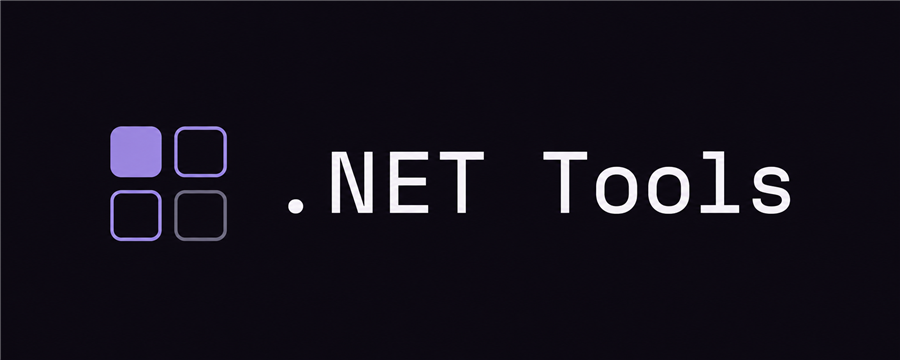

<p align="center">
  
</p>

# .NET Tools

Browser utilities for .NET developers. Paste on the left, read the result on the right, copy, move on. Everything runs client-side, so nothing you type leaves the page. No analytics, no tracking. Check the network tab if you don't believe it.

**[eladser.github.io/.net-tools](https://eladser.github.io/.net-tools/)**

## What's in it

Twenty-five tools. The ones worth calling out:

- **JSON to C#** converts snake_case keys to PascalCase properties with `[JsonPropertyName]`, recognizes dates and GUIDs, merges array items into a single type, and knows when a number needs `long`.
- **GUID generator** does random v4 and the time-ordered v7 layout that `Guid.CreateVersion7()` produces in .NET 9.
- **Config to env vars** turns appsettings.json keys into the `Section__Key` form Docker and Kubernetes want, and back.
- **Date format tester** renders `DateTime.ToString` format strings live as you type.
- **.NET versions** is a reference table of TFMs, C# pairings, and support windows. Each release expands to its major features, Framework 4.8.1 through the .NET 11 preview.

The rest: JSON formatter, JSON/YAML converter, ULID and password generators, SHA-256/384/512 (plus legacy SHA-1 and MD5), cron builder, Base64 and Base64Url, URL encoding, string escaping including C# 11 raw literals, case converter, number bases (BigInt, no precision loss), file sizes, Unix timestamps, TimeSpan math, JWT decoder, stack trace parser, connection strings for six databases, enum flags visualizer, regex tester, and HTTP status codes.

Most tools carry a reference section below them: common cron schedules that load into the builder on click, the `DateTime` format specifier table, .NET naming conventions, JWT claims, which NuGet driver goes with which database, config provider precedence, and the GUID v4-vs-v7 story.

Every tool has its own link (`/#json-to-csharp`, `/#guid`). Press `/` to search. Installs as an offline app from the address bar in Chrome or Edge.

## Development

```bash
git clone https://github.com/eladser/.net-tools.git
cd .net-tools
npm install
npm run dev      # localhost:3001
npm run build
npm run lint
```

React 19, Vite 8, Tailwind 4, TypeScript. Runtime dependencies: React and js-yaml, nothing else.

## License

MIT
